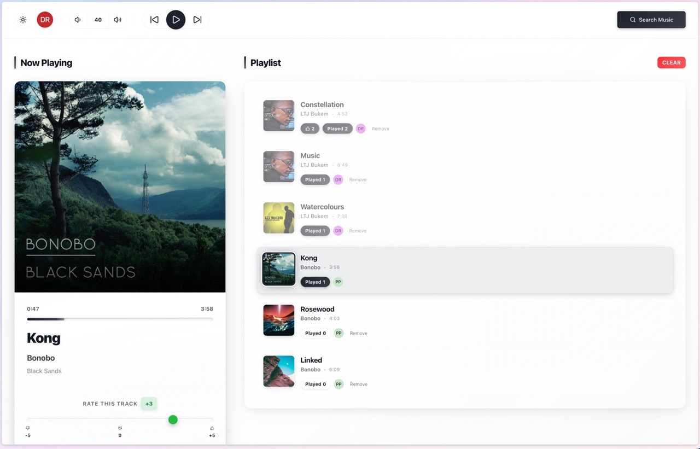

# Jukebox 2.0

An WebSocket/[Mopidy](https://github.com/mopidy) event powered JukeBox client and API



## Background

This is a work-in-progress replacement for our [existing office JukeBox](https://github.com/kyan/jukebox) that was started back on *9th Jan 2009*. That was/is a [Rails](https://github.com/rails) application with many moving parts and orginally connected to [MPD](https://github.com/MusicPlayerDaemon/MPD) directly via a socket. It has been through many modernising iterations, and now uses `Mopidy` but still has the moving parts and uses a socket connection (which now needs buffering). Things have moved fast in nearly 10 years, so it's time to make a fresh start using some new better fitting technologies.

## Overview

The Jukebox re-imagined still uses `Mopidy` but has been split into parts, Client and API (FE and BE). Both the FE and BE are written in [TypeScript](https://www.typescriptlang.org/) and run on the [Bun](https://bun.sh/) runtime. It uses SQLite for data persistence and communicates via smaller event messages passed back and forth over a websocket. Currently both the FE and BE live in this one monorepo.

### Tech Stack

- **Runtime**: [Bun](https://bun.sh/) - Fast JavaScript runtime and package manager
- **Monorepo**: Bun workspaces with two packages:
  - `@jukebox/frontend` - React application with Bun dev server
  - `@jukebox/backend` - TypeScript API running on Bun with Socket.IO
- **Task Runner**: [Just](https://github.com/casey/just) command runner
- **Music Server**: Mopidy (running in Docker)
- **Database**: SQLite

### Architecture

```
┌──────────────────────────────────────────────────────────────┐
│                         justfile                             │
│               (Single Source of Truth)                       │
│   All commands defined here: dev, build, test, deploy       │
└────────────────────────┬─────────────────────────────────────┘
                         │
                         ├─→ Development: dev, dev-fe, dev-be
                         ├─→ Testing: test, test-frontend, test-backend
                         ├─→ Building: build-all, build-frontend, build-backend
                         ├─→ Docker: docker-build-all, docker-run-all
                         └─→ Deployment: kamal-deploy, kamal-setup
```

## Quick Start

```kyan-jukebox-v2/README.md#L44-57
# Install dependencies and start Mopidy
just setup

# Start full development environment (frontend + backend)
just dev

# Or start services individually
just dev-fe    # Frontend only
just dev-be    # Backend only

# Run tests
just test

# Validate code (lint + type-check)
just check
```

## Why not use an existing Mopidy frontend

We have extra requirements for our office Jukebox to make it more interactive and office friendly, Mopidy just handles playing music. This projects adds some of these extra features:

* Information about who added a track to the playlist
* Ability for other users to rate the current track playling
* An auto track chooser that adds music when the playlist runs out
* Auto switch off
* Search for music ordered by previous vote popularity

## Requirements

* [Bun](https://bun.sh/) runtime (v1.3 or later)
* [Docker](https://www.docker.com/) (for running Mopidy)
* [Just](https://github.com/casey/just) command runner
* A `Google` account (for easy user management)
* A premium `Spotify` account (for the music)

```kyan-jukebox-v2/README.md#L82-84
$ git clone https://github.com/kyan/jukebox-js
$ cd jukebox-js
```

## Environment

Running the app locally requires some environment variables to be set in the various applications. There are a bunch of `.env.example` files that just need to be duplicated in the folder they are in and the various missing parts filled in. The comments in those files should help you.

## Development

The app uses `just` to make running common tasks easier. Run `just` or `just --list` to see all available commands.

### Common Commands

| Command | Description |
|---------|-------------|
| `just setup` | Install dependencies and start Mopidy |
| `just dev` | Start both frontend and backend with hot reload |
| `just dev-fe` | Start only frontend with hot reload |
| `just dev-be` | Start only backend with hot reload |
| `just build-all` | Build both frontend and backend for production |
| `just test` | Run all tests in CI mode |
| `just test-frontend` | Run only frontend tests |
| `just test-backend` | Run only backend tests |
| `just test-watch` | Run backend tests in watch mode |
| `just check` | Lint and type-check all code |
| `just fix` | Auto-fix linting and formatting issues |
| `just deps-start` | Start Mopidy Docker container |
| `just deps-stop` | Stop Mopidy Docker container |

See [docs/DEV_WORKFLOW.md](docs/DEV_WORKFLOW.md) for detailed documentation.

### Running the tests

There is currently 100% tests and coverage throughout the app as well as linting and prettier via ESLint.

Run all the tests in the same way it does on CI:
```kyan-jukebox-v2/README.md#L120-121
$ just test
```

Run just the tests for the FE or BE:
```kyan-jukebox-v2/README.md#L124-127
$ just test-frontend
$ just test-backend
$ just test-watch       # Backend tests in watch mode
```

You can also run any workspace command directly:
```kyan-jukebox-v2/README.md#L130-134
$ just fe test          # Run frontend tests
$ just be test          # Run backend tests
$ just be validate      # Lint and type-check backend
$ just fe validate      # Lint and type-check frontend
```

You can also just ignore `just` and run everything manually if that's your thing.

### Running the app

When running the app locally you get to run a Docker instance of Mopidy on your machine. You don't get any sound but it's by far the easiest way. The SQLite database will be stored in the `databases/` folder.

The easiest way to get started:
```kyan-jukebox-v2/README.md#L145-147
just setup    # Installs dependencies and starts Mopidy
just dev      # Starts both frontend and backend
```

Or start services individually in separate terminals:
```kyan-jukebox-v2/README.md#L150-151
just dev-fe   # Frontend at http://localhost:3000
```
and
```kyan-jukebox-v2/README.md#L153-154
just dev-be   # Backend at http://localhost:8080
```

This will give you a working FE and BE with SQLite persistence running in dev mode, meaning any changes will cause hot reload.

## Technology

### Client

A ReactJS application that communicates with the JukeBox API.

### API

A Bun runtime application written in TypeScript that communicates with `SQLite` for data persistence and the `Mopidy` Websocket interface using Socket.IO.

##### TypeScript

The project uses TypeScript for type safety and better developer experience. All TypeScript dependencies are managed by Bun and installed locally in the project, so your IDE should have full Intellisense and TypeChecking support out of the box.

### SQLite

The API uses `SQLite` for its persistence layer. In development, the database file is stored in the `databases/` folder. In production, it should be placed at `/var/lib/jukebox/jukebox.db` and the `SQLITE_PATH` environment variable should point to this location.

### Adding a new package

To add a new package to the project, use Bun's package manager:

```kyan-jukebox-v2/README.md#L183-190
# Add to a specific workspace
bun add <package> --filter @jukebox/backend
bun add <package> --filter @jukebox/frontend

# Or add from within the workspace directory
cd backend && bun add <package>
cd frontend && bun add <package>
```

The package will be automatically added to the appropriate `package.json` file and `bun.lock` will be updated.

### Mopidy

If you so want to run your own version of Mopidy for running in production, you can buy yourself a Raspberry Pi and follow [these instructions](docs/mopidy_install.md).

## Deployment

The application uses [Kamal](https://kamal-deploy.org/) for deployment to production servers.

### Deploy to Production

Build Docker images and deploy:
```kyan-jukebox-v2/README.md#L206-208
$ just kamal-deploy-frontend   # Deploy frontend application
$ just kamal-deploy-backend    # Deploy backend application
```

### Manage Deployment

```kyan-jukebox-v2/README.md#L212-214
$ just kamal-status-frontend   # Check frontend deployment status
$ just kamal-status-backend    # Check backend deployment status
```

### Building Docker Images

You can build Docker images locally:
```kyan-jukebox-v2/README.md#L219-222
$ just docker-build-all              # Build both frontend and backend
$ just docker-build-frontend         # Build frontend only
$ just docker-build-backend          # Build backend only
```

### Database

In production the API uses SQLite. The database file should be manually copied to `/var/lib/jukebox/jukebox.db` on the host machine and the `SQLITE_PATH` environment variable should be set to this path.
